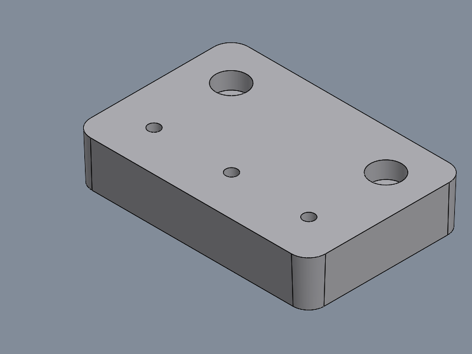
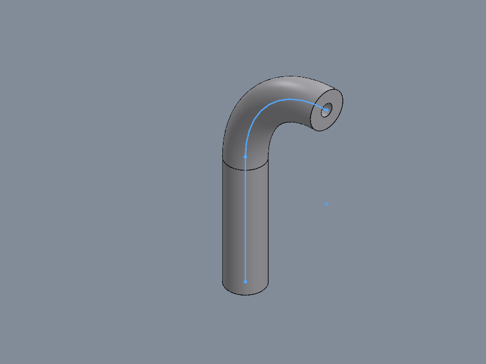
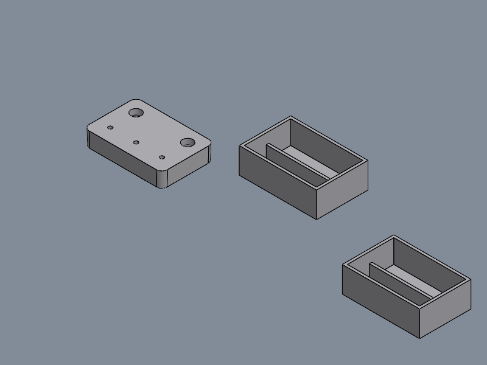

# SolidWorks MCP Server

Control SolidWorks from Claude in plain language: parts, assemblies, drawings, exports.
**105 tools** · tested live on **SOLIDWORKS 2026** · Windows · Python 3.10+

[](LICENSE)
[](https://modelcontextprotocol.io/)
[](https://www.solidworks.com/)

| | | |
|:-:|:-:|:-:|
|  |  |  |
| Hole Wizard, fillet, draft | Sweep along line + arc | Component pattern, mates |

> 📘 Full manual (Vietnamese, Word): [docs/SolidWorks_MCP_Huong_dan.docx](docs/SolidWorks_MCP_Huong_dan.docx)

## Quick start

Requires Windows, SolidWorks, Python 3.10+ (64-bit) and Claude Desktop.

```bat
git clone https://github.com/TanPhan97/solidworks-mcp.git D:\Solidworks-mcp
cd D:\Solidworks-mcp
py -3 -m venv .venv
.venv\Scripts\python.exe -m pip install -r requirements.txt
.venv\Scripts\python.exe scripts\register_claude_desktop.py
```

Then **Quit** Claude Desktop from the system tray, reopen it, and check that **Settings → Developer** shows `solidworks` as running.
Try: *"Connect to SolidWorks and tell me the version."*

If the server does not show up, pass the file from **Settings → Developer → Edit Config** explicitly:
`register_claude_desktop.py --config "C:\path\to\claude_desktop_config.json"` (also: `--list`, `--dry-run`, `--remove`).

## What you can ask

- *"New part: 60×40 rectangle on Top, extrude 10 mm, three M3x0.5 tapped holes 8 deep, fillet the vertical edges R3, material 6061-T6, save to D:\Work\plate.SLDPRT and show me an isometric view."*
- *"Change Boss-Extrude1 depth to 12 mm"* · *"Create global variable Wall = 2 and drive the shell thickness with it."*
- *"New assembly with plate and cover, mate them, pattern the cover 3× at 100 mm, check interference, make an exploded view."*
- *"Drawing of plate.SLDPRT: 3 views + iso, section A-A, detail at 3:1, model dimensions, center marks, then export PDF."*
- *"Export every part in D:\Project to STEP and STL, drawings to PDF."*

## Tools

| Group | Tools |
|---|---|
| **Connection & documents** (12) | `connect_solidworks`, `get_solidworks_info`, `create_new_part`, `create_new_assembly`, `open_document`, `import_file`, `save_document`, `close_document`, `activate_document`, `get_document_info`, `list_open_documents`, `set_units` |
| **Sketch** (21) | `create_sketch`, `create_sketch_on_face`, `close_sketch`, `get_sketch_status`, `draw_line`, `draw_circle`, `draw_rectangle`, `draw_arc`, `draw_polygon`, `draw_centerline`, `draw_slot`, `draw_spline`, `draw_ellipse`, `sketch_fillet`, `convert_entities`, `offset_entities`, `sketch_mirror`, `sketch_pattern`, `set_construction`, `add_sketch_dimension`, `add_sketch_relation` |
| **Part features** (17) | `extrude`, `extrude_sketch`, `cut_extrude`, `revolve`, `loft`, `sweep`, `fillet_edges`, `chamfer_edges`, `shell`, `rib`, `draft`, `hole_wizard`, `linear_pattern`, `circular_pattern`, `mirror`, `create_ref_plane`, `create_ref_axis` |
| **Selection & topology** (8) | `list_edges`, `list_faces`, `select_edges`, `select_faces`, `select_entity`, `clear_selection`, `get_selection`, `measure` |
| **Parametric edit** (15) | `list_features`, `get_feature_info`, `edit_feature`, `list_dimensions`, `set_dimension`, `list_equations`, `set_equation`, `list_configurations`, `add_configuration`, `activate_configuration`, `suppress_feature`, `delete_feature`, `rename_feature`, `rebuild`, `undo` |
| **Properties & output** (8) | `get_mass_properties`, `set_material`, `set_custom_property`, `get_custom_properties`, `export_document`, `batch_export`, `set_view`, `capture_view` |
| **Assembly** (11) | `insert_component`, `add_mate`, `list_components`, `list_mates`, `move_component`, `fix_component`, `set_component_state`, `replace_component`, `component_pattern`, `check_interference`, `create_exploded_view` |
| **Drawing** (12) | `create_drawing`, `list_drawing_views`, `add_drawing_view`, `add_section_view`, `add_detail_view`, `insert_model_annotations`, `insert_center_marks`, `insert_bom`, `auto_balloon`, `add_note`, `add_sheet`, `activate_sheet` |
| **Advanced** (1) | `execute_python` |

All lengths take an optional `unit` (mm default; cm, m, inch, ft). Angles are in degrees.

## Configuration (optional)

`solidworks_mcp/config.json`. Every key is optional, and `auto` means auto-detect:

```json
{ "default_unit": "mm", "part_template": "auto", "assembly_template": "auto",
  "drawing_template": "C:\\Templates\\A4.drwdot", "log_level": "INFO" }
```

Logs go to `solidworks_mcp/solidworks_mcp.log`; stdout is reserved for MCP.

## Testing

```bat
.venv\Scripts\python.exe -m pytest -q solidworks_mcp\tests          :: offline, fake COM (48 tests)
.venv\Scripts\python.exe scripts\smoke_test.py D:\swmcp_test        :: live, SolidWorks open (126 checks)
```

Use a new output folder for each smoke run. SolidWorks cannot open two files with the same name.

## Troubleshooting

| Problem | Fix |
|---|---|
| Server missing in Claude Desktop | Register with `--config` (Store installs use another folder), then fully Quit and reopen |
| "No part template found" | Set `part_template` in config.json or a default template in SolidWorks Options |
| A tool hangs or times out | A modal dialog is open in SolidWorks: close it. The known dialogs are suppressed in code |
| "Critically low on memory" | Too many open documents: close some |

## Safety

`execute_python` runs arbitrary Python with your user rights. Use it only in trusted setups, or remove it from `TOOL_TABLE` in `solidworks_mcp/tools_ext.py`.
The server never calls CloseAllDocuments, and batch export never closes documents that were already open or have unsaved changes.

## Project layout

```
solidworks_mcp_server.py      entry point (launched by Claude Desktop)
solidworks_mcp/server.py      MCP server: list_tools / call_tool
solidworks_mcp/tools_ext.py   tool registry: schema + dispatch for all 105 tools
solidworks_mcp/automation/    SolidWorks logic (documents, sketch, features, drawing, assembly…)
solidworks_mcp/tests/         offline unit tests
scripts/                      smoke test, Claude Desktop registration
```

To add a tool, write the method in an `automation/` mixin and add one line to `TOOL_TABLE` and `CATEGORIES`.

## Credits

Original project by **Samsaam Ali Baig** ([alisamsam/solidworks-mcp](https://github.com/alisamsam/solidworks-mcp)), MIT License.
v4.x extensions (part / assembly / drawing tools, registry, tests) by **Phan Chu Tan**.
